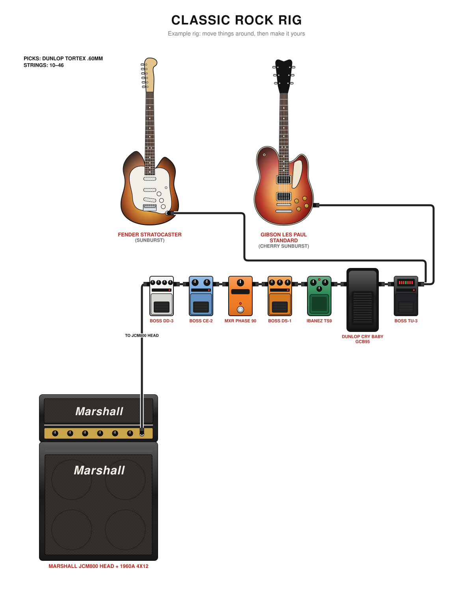

# Rigsketch

Draw your guitar rig in the browser: guitars, pedalboard, amps and the cables between them, in the spirit of the old Guitar Geek rig diagrams, with a cleaner, flat look.

**▶ Open the app: https://andrearufo.github.io/rigsketch/**



## Features

- 100+ assets: Fender, Gibson, PRS, Ibanez, Gretsch, Martin guitars and basses; Marshall, Fender, Vox, Orange, Mesa/Boogie, Peavey, Roland, Boss, Ampeg amps and cabs; Boss, MXR, Ibanez, Dunlop, Electro-Harmonix, ProCo, Klon, Fulltone, Strymon, TC Electronic, Line 6, Digitech and more pedals; multi-FX and rack units.
- Flat illustrations in the spirit of Guitar Geek: guitars drawn from their real dimensions, pedals without tiny print, the name of every item in a caption underneath.
- Everything snaps to a **20 px grid**.
- Drag from an output jack to an input jack: the cable **routes itself** with horizontal and vertical runs around your gear. Drag any segment to adjust it.
- Notes, custom colours and finishes (sunburst, cherry burst…), left-handed guitars, cable labels, free text.
- **Custom pedal** and **custom rack unit** assets: set the name, knobs and colour for anything not in the library yet.
- **Stereo outputs, FX loops and speaker outs** on the gear that has them, plus an A/B/Y box for two-amp rigs. Hover a jack to see its name.
- Export to **PNG** (2×) or **SVG**. Save and open rigs as **`.rig.json`** files, or **Share link**: the whole rig, compressed, travels in the link itself (nothing is uploaded anywhere).
- Undo/redo, autosave in the browser. No account, no server, no build step.

## Request a new asset

Missing a pedal, amp or guitar? [Open an asset request](https://github.com/andrearufo/rigsketch/issues/new?template=asset-request.yml) (there is also a link in the app). A front photo and the knob labels are all we need.

## File format

A rig is a plain JSON file (`.rig.json`), easy to read, diff and generate:

```json
{
  "format": "rigsketch",
  "version": 1,
  "title": "My rig",
  "subtitle": "",
  "paper": { "w": 1200, "h": 1500 },
  "items": [
    { "id": "i1", "asset": "fender-stratocaster", "x": 330, "y": 120, "note": "Sunburst", "color": "sunburst", "flip": false },
    { "id": "i2", "asset": "boss-ds-1", "x": 600, "y": 640 },
    { "id": "i3", "asset": "custom-pedal", "x": 500, "y": 640, "label": "My fuzz", "params": { "knobs": ["VOL", "FUZZ"] } }
  ],
  "cables": [
    { "from": "i1", "to": "i2" },
    { "from": "i2", "to": "i3", "fromJack": "out2", "label": "to amp", "color": "#1f1f1f", "points": [[480, 600], [440, 600]] }
  ]
}
```

| Field | Meaning |
|---|---|
| `items[].asset` | An `id` from [`assets/catalog.json`](assets/catalog.json). Unknown ids show as a “?” placeholder instead of breaking the file. |
| `items[].x`, `y` | Top-left position on the paper, in px, snapped to the 20 px grid. Order of `items` is the drawing order. |
| `label`, `note` | Override the name in the caption; extra line shown under it. |
| `color` | `#rrggbb`, or a finish: `sunburst`, `cherryburst`, `tobacco`. |
| `flip` | Mirror horizontally (left-handed guitars). |
| `caption` | Show the caption under the item (default on). |
| `params` | Only for custom assets and text: `knobs`, `size`. |
| `cables[]` | From an item’s output to another item’s input. `points` is only present when a route was adjusted by hand; without it the route is computed. |
| `fromJack`, `toJack` | Which jack, when it is not the main `out` / `in`: `out2`, `in2` (stereo or A/B), `send`, `return` (FX loop), `spk` (speaker out). |

## Add an asset yourself

Assets are data, not drawings: each entry in [`assets/catalog.json`](assets/catalog.json) picks a **template** and sets its parameters.

```json
{"id": "boss-ds-1", "category": "pedal", "brand": "Boss", "model": "DS-1", "kind": "Distortion",
 "template": "boss", "params": {"color": "#f08a24", "knobs": ["TONE", "LEVEL", "DIST"]}}
```

| Template | For | Main params |
|---|---|---|
| `guitar` | guitars & basses | `shape` (strat, tele, lespaul, sg, semihollow, prs, offset, explorer, flyingv, dread, pbass, jbass), `head` (fender, gibson, bass, pointy, acoustic), `color`, `guard`, `board`, `pickups`, `pickupColor`, `ring`, `binding`, `hardware`, `knob` |
| `boss` | Boss compact pedals | `color`, `knobs` (count), `display`, `sliders` |
| `ts` | Tube Screamer-style | `color`, `knobs` |
| `box` | any stompbox | `w`, `h` (multiples of 20), `color`, `knobs`, `switches`, `display`, `accent` |
| `round` | Fuzz Face-style | `color`, `knobs` |
| `wah` | wah, volume, Whammy | `w`, `h`, `color`, `text`, `panelW` |
| `multifx` | floor modelers | `w`, `h`, `switches`, `knobs` |
| `rack` | rack units | `u`, `knobs`, `screen` |
| `head`, `combo`, `cab` | amps | `color` (tolex), `panel`, `grille`, `weave`, `knobs`, `speakers`, `logo`, `logoColor`, `logoPos`, `italic` |
| `text` | free text | `size` |

### Guitar drawings

Guitars with an `art` param use a public-domain (CC0) drawing from [`assets/art/`](assets/art): the body and pickguard are recoloured, everything else is drawn as is. To add one, drop the SVG in `assets/art/`, add it to `SOURCES` in [`tools/build-art.mjs`](tools/build-art.mjs) (ids of the body and pickguard elements, credit), run `node tools/build-art.mjs`, and set its output jack in `ART_JACK` in `js/draw.js`. Only CC0 or public-domain drawings, please. The other guitars are drawn from their real dimensions by the `shape` templates.

Then run the checks and open a pull request:

```bash
node test/check.mjs
```

Extra jacks: `stereo` (second output), `stereoIn` (second input), `loop` (FX send/return) on pedals, multi-FX and amps; amp heads always have a speaker out and cabinets a speaker input. Sizes are multiples of the 20 px grid and jacks sit on grid lines (the check enforces it). Brand and model names appear as plain text only, to identify the gear. No logos or trademarks are reproduced, and all drawings are generic and stylised. Rigsketch is not affiliated with any of the brands listed.

## Credits

Guitar drawings of the Stratocaster, Les Paul, Jazz Bass and Jag-Stang by **piemaster**, from [Wikimedia Commons](https://commons.wikimedia.org/wiki/File:Fender_Stratocaster.svg); SG, Explorer, Flying V and Jet Firebird by **piemaster**, from [Openclipart](https://openclipart.org/detail/16718). All CC0 (public domain): credited with thanks, not by obligation.

## Run locally

It is a static site with no dependencies:

```bash
python3 -m http.server 8080
```

Then open http://localhost:8080.

## License

[MIT](LICENSE)
